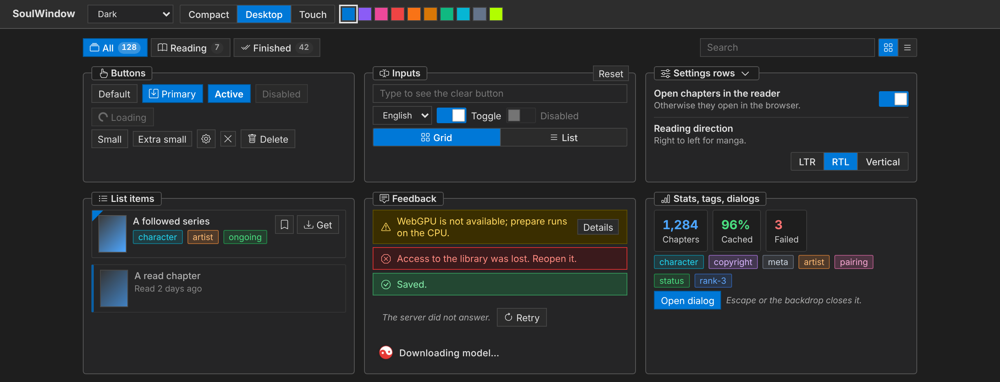
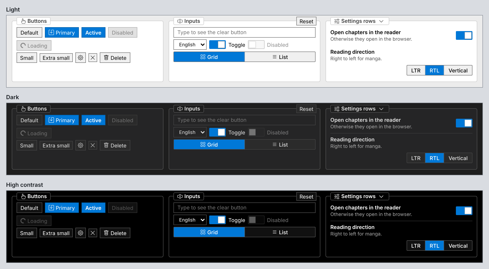
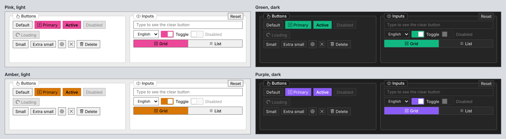
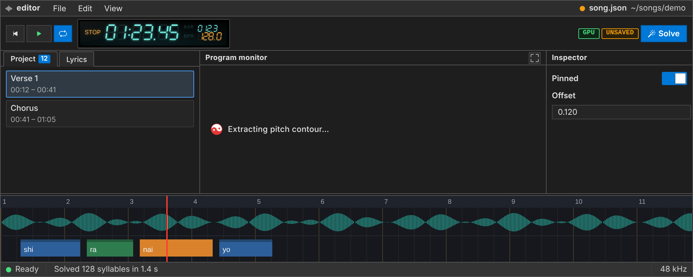
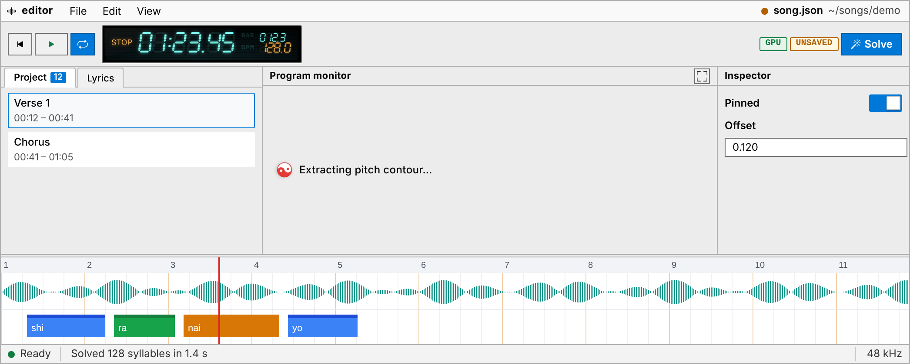
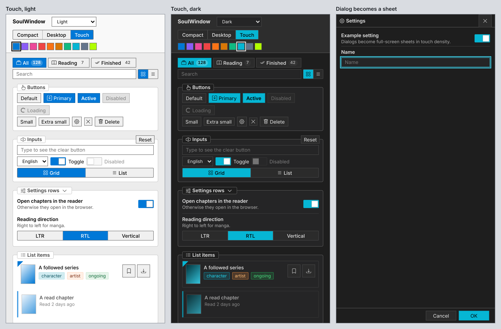

# SoulWindow

The WinForms-style design system shared by **DynastyReader**, **Lyric-Sync**, **probable-video-editor** and **Project-Curator**: dense, flat, 1px borders, Segoe UI, group boxes rather than cards, no emoji.

One set of tokens and themes, one cascade-layer order, and one class vocabulary (`.win-button`, `.group-box`, `.input-field`, `.ds-modal-*` …). Solid components and plain-DOM helpers render the same markup on top of it, and a pro layer adds the DAW/NLE editor chrome.



## What it looks like

### Three themes

Light, dark and high contrast. Themes only change colours; every component reads tokens, so nothing needs per-theme CSS.



### Any accent colour

One colour (a preset or any hex) drives primary buttons, selection, toggles, focus rings and links, and is adjusted per theme so it stays readable.



### Editor layer (DAW / NLE)

`css/pro/daw.css` adds the editor chrome Lyric-Sync and probable-video-editor share: menu bar, transport with a VFD readout, docks and tabs, a timeline frame whose canvas colours come from `--tl-*` tokens, and a status bar. It follows the theme and accent like everything else.



<details>
<summary>The same editor in the light theme</summary>



</details>

### Phones

`data-density="touch"` keeps the compact WinForms look but makes row actions 32px touch targets, lets tab rows scroll sideways, stacks settings rows, and turns dialogs into full-screen sheets that respect the safe area.



To try it yourself: `npm install && npm run dev` opens the showcase, with switches for theme, density and accent at the top.

```
css/          tokens, themes, density, reset, base, components, mobile, utilities   (framework-free)
css/pro/      daw.css: menu bar, transport, VFD readout, docks, tabs, splitter, timeline frame, status bar
runtime/      theme / accent / density controller, pre-paint boot script, Vite plugin, readTokens(), seg7
solid/        Solid components: Button, GroupBox, InputField, SubTabs, Modal, ListItem, SettingsRow, Feedback …
solid/pro/    MenuBar, LcdDigits
vanilla/      DOM factories with the same markup, for apps without a framework
showcase/     every component in every theme and density (npm run dev)
```

## Use it

```sh
npm install github:FuouM/soulwindow#v0.2.1     # or: bun add github:FuouM/soulwindow#v0.2.1
```

Installing from git runs `prepare`, which builds `dist/` (the Solid components). CSS, `runtime/` and `vanilla/` are plain files and need no build.

```ts
// vite.config.ts: paints the saved theme before first paint (no white flash in dark mode)
import { soulwindow } from "soulwindow/vite";
export default defineConfig({ plugins: [solid(), soulwindow({ storagePrefix: "myapp-" })] });
```

```ts
// main.tsx
import "bootstrap-icons/font/bootstrap-icons.css";
import "soulwindow/css";
import "soulwindow/css/pro/daw.css"; // editors only
import { createSoulWindow } from "soulwindow/runtime";

export const sw = createSoulWindow({ storagePrefix: "myapp-", density: "auto" }); // same options as the plugin
```

```tsx
import { Button, GroupBox, IconText, Icon, useSoulWindow } from "soulwindow/solid";

const s = useSoulWindow(sw);         // s.theme(), s.accent(), s.density(), s.isDark()
sw.setTheme("dark");                 // light | dark | high-contrast
sw.setAccent("pink");                // preset id or any hex
sw.setDensity("touch");              // compact | comfortable | touch

<GroupBox title={<IconText icon={<Icon name="gear" />}>General</IconText>}>
  <Button variant="primary" text="Save" />
</GroupBox>
```

Without Solid:

```ts
import { button, groupBox } from "soulwindow/vanilla";
const box = groupBox({ title: "General", icon: "gear" });
box.body.append(button({ text: "Save", variant: "primary", onClick: save }));
```

Canvas code (timelines, waveforms) reads colours from tokens, so it follows themes too:

```ts
import { readTokens } from "soulwindow/runtime";
let tl = readTokens("--tl-");          // { bg, laneAlt, clip, clipHead, playhead, … }
sw.subscribe(() => (tl = readTokens("--tl-"), repaint()));
```

## The three axes

| Axis | Set by | Changes | Values |
|---|---|---|---|
| Theme | `data-theme` on `<html>` | colours only | `light`, `dark`, `high-contrast` |
| Accent | inline custom properties from the runtime | `--sys-accent`, `--sys-primary`, highlight, focus, link, primary buttons | 10 presets or any hex |
| Density | `data-density` on `<html>` or any container | sizes only | `compact` (DAW), none (desktop), `touch` (phones) |

They are independent: any theme with any accent at any density.

### Add-on themes

The core ships light, dark and high contrast. A styled theme such as Windows 7 Aero is an add-on that lives in the app (or later in its own package):

```ts
const sw = createSoulWindow({ themes: { ...DEFAULT_THEMES, windows7: { family: "light", label: "Windows 7", meta: "#3a8bdc", bg: "#d2e6f9", text: "#162030" } } });
```

plus its own `:root[data-theme="windows7"] { … }` tokens and chrome CSS in `@layer app`. `family` picks the accent rules it inherits; extra accent tints it needs (gradients, glass) are derived from `sw.kit` (`adjust`, `deepText`, `linkColor`) in a `sw.subscribe()` callback. An editor can sit at `compact` inside a page at desktop density (the showcase does this).

## Tokens

| Prefix | What | Notes |
|---|---|---|
| `--sys-*` | system colours | The public colour API. Use these. |
| `--sw-*` | density sizes, component tokens, generic status (`--sw-ok/warn/err`) | New in SoulWindow. |
| `--space-*`, `--font-*`, `--radius-*`, `--z-*` | scales | `--z-*` is the only allowed source of global z-index. |
| `--ds-*` | status / danger colours | DynastyReader's names, kept for compatibility. Do not add more. |
| `--tag-*` | tag taxonomy for `.tag-pill` | |
| `--tl-*`, `--lcd-*` | pro: timeline canvas, VFD readout | |

## Cascade layers

`layers.css` declares the order once:

```
tokens → themes → density → reset → base → layout → components → pro → app → utilities → mobile
```

Put app styles in `@layer app { … }`. Unlayered CSS beats every layer, so it overrides SoulWindow by accident; keep it for real emergencies.

## Develop

```sh
npm install
npm run dev              # showcase on localhost
npm run build            # dist/: esm (compiled Solid), source (JSX kept, for the `solid` export condition), types
npm run check            # typecheck + tests + build (tests include: no hex colours outside tokens/themes)
npm run build:showcase && npm run screenshots   # PNGs of every theme × density into screenshots/
npm run build:showcase && npm run readme-images # regenerate the images in docs/images/ for this README
```

The migration plan for each app is in [docs/migration.md](docs/migration.md). Rules for coding agents are in [AGENTS.md](AGENTS.md).
